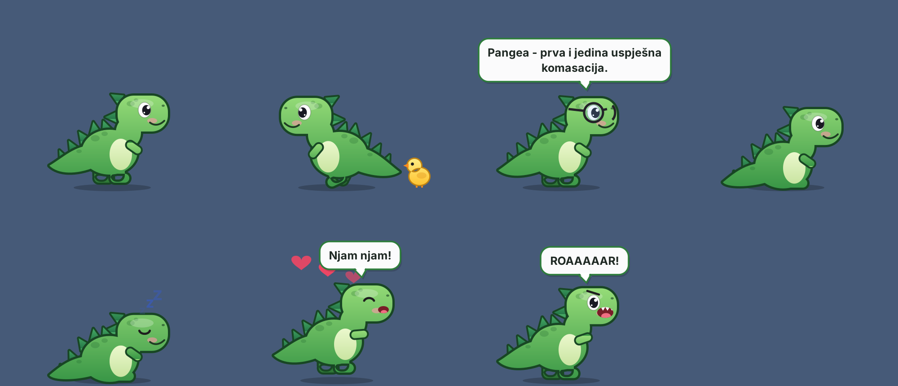

# Dino Joe - Desktop Pet 🦖

**EN** | [SR](#sr)

A tiny dinosaur that lives on your Windows desktop. It hatches from an egg, grows up, walks around, sleeps, tells jokes, wants to be fed and petted - and, if you want, becomes an AI chatbot.

- **Works offline.** No account, no internet needed - jokes, moods and care work out of the box.
- **Optional AI.** Bring your own key (Groq, Gemini, OpenAI, Claude, OpenRouter or local Ollama) and the dino starts chatting. Your key is stored locally, encrypted (DPAPI).
- **Joke packs.** Jokes come in packs you can enable, disable, mix and remove. Community packs live in [dino-joe-packs](https://github.com/freedole/dino-joe-packs).
- **Tiny.** ~100 KB exe, no runtime to install (uses .NET Framework 4.x that ships with Windows 10/11).
- **Balkan humor** built in. English packs too.

> **v1.1** - evolution (egg -> baby -> juvenile -> adult), 18 achievements, 6 species (Stegosaurus and Pterodactyl unlockable), 12 colors, 7 patterns, 10 accessories, 9 personalities, care status, ~1000 jokes (SR + EN), joke packs with an online catalog, optional AI.



## Download

Grab the latest zip from [Releases](https://github.com/freedole/dino-joe/releases), unzip, run `DinoJoe.exe`.

Windows SmartScreen may warn about an unknown publisher (the exe is not code-signed yet). Click *More info → Run anyway*. Each release has a `.sha256` file so you can verify the download.

## Build from source

No SDK needed - Windows already has the C# compiler:

```bat
git clone https://github.com/freedole/dino-joe
cd dino-joe
build.bat
```

Output: `build\DinoJoe.exe`. Every push is also built by GitHub Actions; tags `v*` publish a Release.

## Roadmap

- **v1.0** ✓ - first-run wizard, 5 languages, ODjordje / ODjordjina, 4 species, colors, patterns, accessories, 9 personalities incl. *Hardcore Tamagotchi mode*, care status, joke packs & profiles & catalog, AI services (Groq, Gemini, OpenAI, Claude, OpenRouter, Ollama)
- **v1.1** ✓ - evolution (egg → baby → juvenile → adult), achievements, Stegosaurus & Pterodactyl, Gold & Rainbow patterns, MSIX package for Microsoft Store
- **v1.2+** - mini games, seasonal skins, physics

## Privacy

No account, no ads, no telemetry. See [PRIVACY.md](PRIVACY.md).

## License

Code: [MIT](LICENSE). Joke packs: CC BY-SA 4.0.

---

<a id="sr"></a>
## SR

Mali dinosaurus koji živi na tvom Windows desktopu. Izleže se iz jajeta, raste, šeta, spava, priča fore, traži da ga nahraniš i pomaziš, a ako želiš, postaje i AI chatbot.

- **Radi offline.** Bez naloga i bez interneta: fore, raspoloženja i briga rade odmah.
- **AI nije obavezan.** Ubaciš svoj ključ (Groq, Gemini, OpenAI, Claude, OpenRouter ili lokalni Ollama) i dino počne da priča. Ključ se čuva lokalno, enkriptovan.
- **Paketi fora.** Uključuješ, isključuješ, miješaš i brišeš pakete. Paketi zajednice su u [dino-joe-packs](https://github.com/freedole/dino-joe-packs).
- **Mali.** Exe od ~100 KB, bez instalacije runtime-a.
- U BCS verziji se zove **ODjordje** / **ODjordjina**.

Preuzimanje: [Releases](https://github.com/freedole/dino-joe/releases). Build: `build.bat`.

Autor: Đorđe Kaurinović ([freedole](https://github.com/freedole)) · [cyber-security.ba](https://cyber-security.ba)
